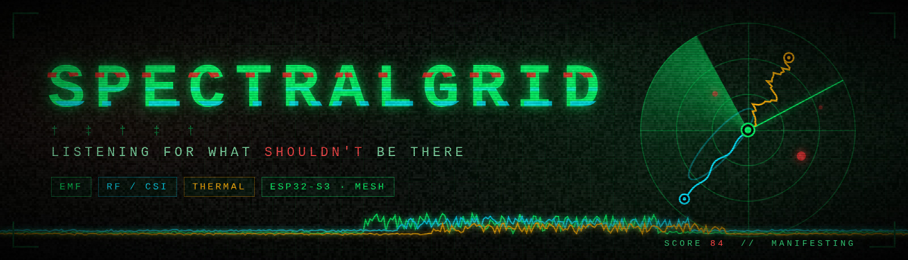
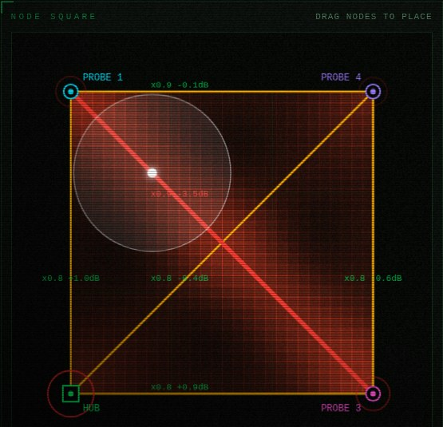
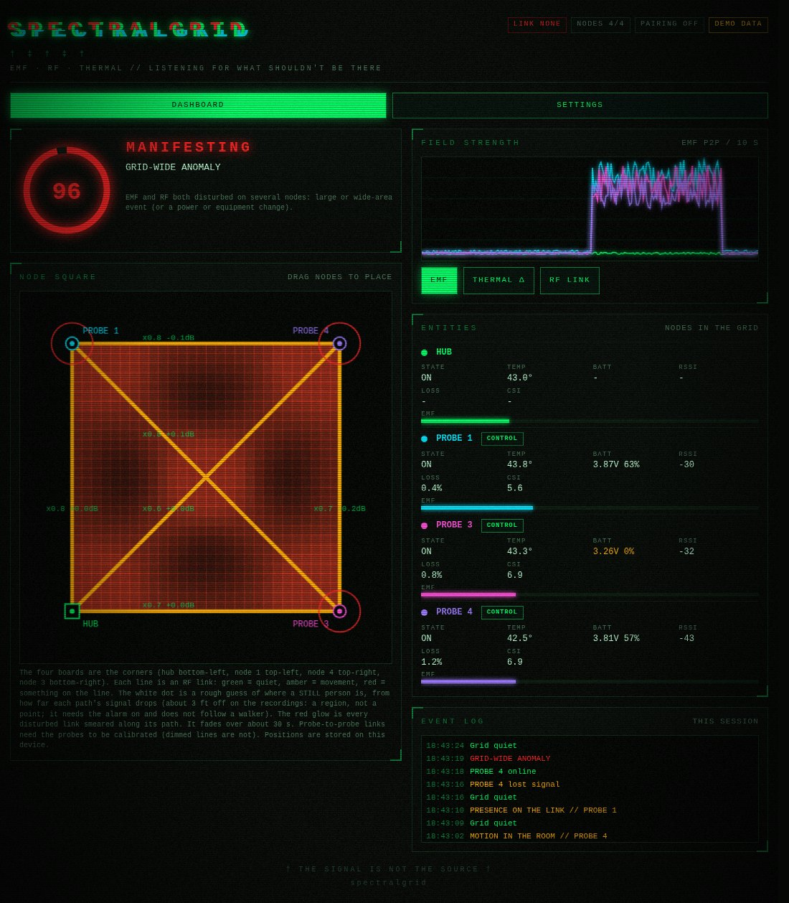
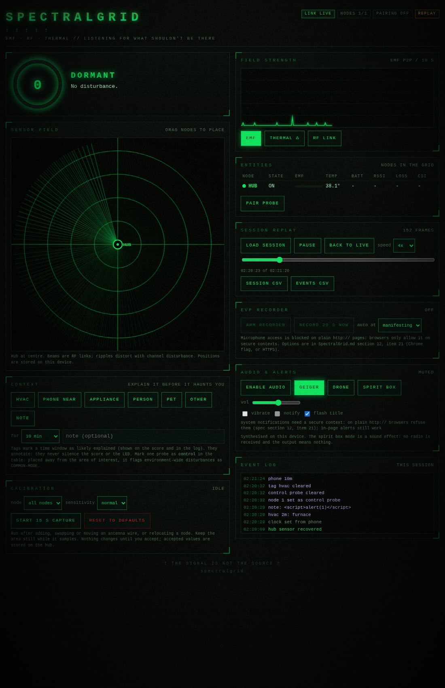
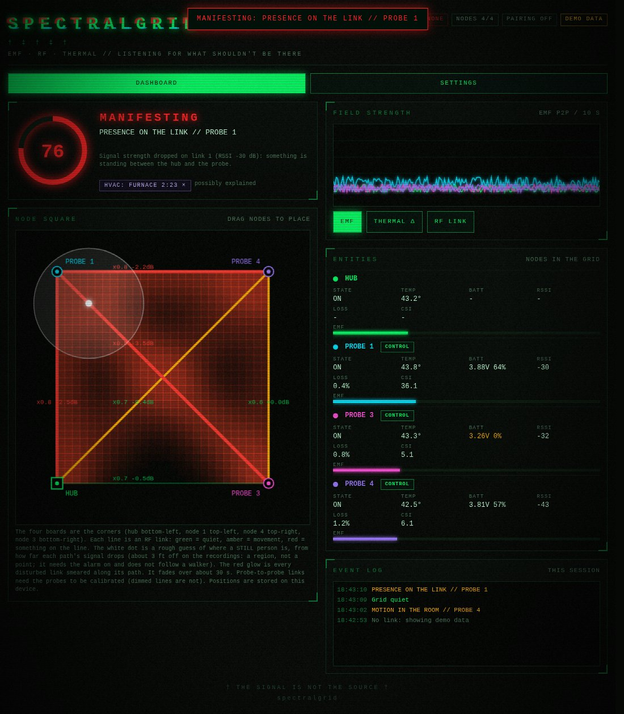
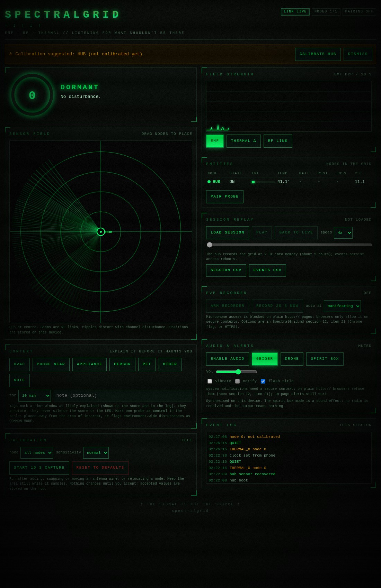
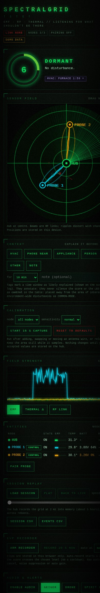
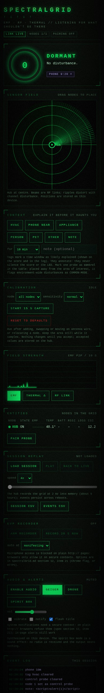
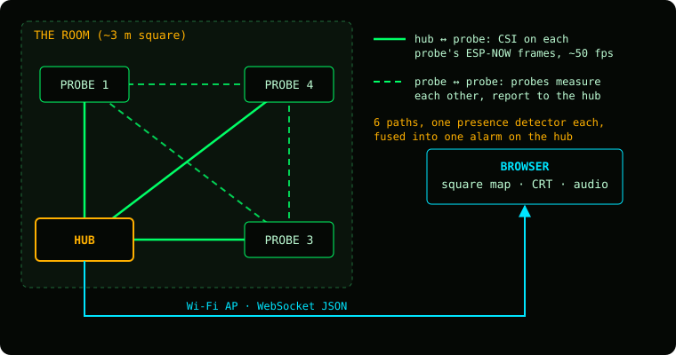

<div align="center">



<br>


**A mesh of ESP32-S3 boards that turns the Wi-Fi between them into invisible tripwires, watches stray electric fields,**
**scores how far the room strays from normal, and shows it on a haunted-CRT dashboard with synthesised Geiger and drone audio.**

[Screenshots](#-screenshots) &nbsp;&bull;&nbsp; [How it works](#-how-it-works) &nbsp;&bull;&nbsp; [Hardware](#-hardware) &nbsp;&bull;&nbsp; [Quick start](#-quick-start) &nbsp;&bull;&nbsp; [Status](#-status) &nbsp;&bull;&nbsp; [Roadmap](#-roadmap) &nbsp;&bull;&nbsp; [Docs](#-docs)

</div>

---

> [!NOTE]
> **Honest scope.** This is a sensor and atmosphere project. Nothing here has been shown to detect anything paranormal. It measures real physical quantities (Wi-Fi multipath, stray capacitive coupling, temperature) that change for ordinary reasons: people moving or standing, appliances cycling, HVAC, a phone in someone's pocket. In practice it is a fairly good **people detector**. The value is a well-instrumented, good-looking record of an environment, not proof of anything.

## 👁 Screenshots

<p align="center"><br><sub><b>Square map, live hub.</b> Four boards, six paths. A walk-through: the probe 1 to probe 3 path turns red, and the dot is the hub's estimate of where the person is.</sub></p>

<table>
<tr>
<td width="50%"><br><sub><b>Manifesting.</b> Grid-wide anomaly: the score ring goes red, the title glitches and the links shatter. (Demo data; the earlier radar view, since replaced by the square map.)</sub></td>
<td width="50%"><br><sub><b>Session replay, live hub.</b> The hub records the grid; here it is being scrubbed and replayed in a real browser, with the real event log (a tag note is shown as plain text).</sub></td>
</tr>
<tr>
<td width="50%"><br><sub><b>Context.</b> Cause tags ("HVAC, furnace" on the score), a battery column that flags the low probe, and per-probe control buttons. (Demo data.)</sub></td>
<td width="50%"><br><sub><b>Drift prompt, live hub.</b> After five minutes uncalibrated the hub suggests a calibration; accepting one clears the banner.</sub></td>
</tr>
<tr>
<td colspan="2" align="center"> &nbsp; <br><sub>Phone layout: a barrier breach on a link (demo data), and the live hub.</sub></td>
</tr>
</table>

More in [`screenshots/`](./screenshots/README.md). They sit outside both firmware builds and are never compiled or uploaded.

## 🛰 How it works

<p align="center"></p>

Every pair of boards is a **path**. The hub measures Wi-Fi channel state (CSI) on the frames each probe sends it; the probes also hear **each other's** broadcasts and send the hub a short summary of every probe-to-probe link. With a hub and three probes in a square that is **6 physical paths** (sides and diagonals), each one a tripwire.

| Piece | Role |
| :--- | :--- |
| **Hub** (`hub/`) | Runs the open access point and captive portal, pairs probes and assigns their time slots, measures CSI per link, runs one presence detector per path and fuses them into a single alarm, scores the room 0-100 with a *vector* (which node or path), keeps an event log, a session recording and an on-flash field log, drives the status LEDs and serves the dashboard. Works alone too. |
| **Probe** (`probe/`) | A small battery beacon: samples a floating wire on GPIO 7 (capacitive EMF) and the chip temperature, transmits ESP-NOW frames in its slot, measures CSI from the other probes and reports it. Mirrors the hub's lights. Updated over the air from the hub. **One binary serves every extra board.** |
| **Shared** (`shared/`) | The wire format and the Arduino-free logic (DSP, presence detector, path fusion, touch, moved-board check), included by both firmwares and unit-tested on the host. |

**Presence detection**

- Per path, two signals: **noise** (how much the channel shimmers; a walker raises it 2-10x) and an **RSSI shadow** (a still body between two boards lowers the received level by a few dB). A person standing still is seen *only* by the shadow.
- Each path is **calibrated** against the empty room (30 s capture, review, accept), then keeps learning slowly so the baseline follows the room; an upward re-learn is provisional, because a person right next to a board can *raise* its RSSI.
- **One alarm rule over all paths** (`shared/pathfuse.h`): with 3 or more calibrated paths, an alarm needs 2 active paths, or 1 strong one; with fewer paths, any one.
- Replayed on recordings: walking 100 %, a still person ~60 %, empty-room false alarms ~1.5 % of seconds over 76 min (mostly real visits). On the board: a 2026-10-16 walk test kept the alarm on from first entry to 5 s after leaving, nothing before or after.
- **Moved-board hint:** if *all* of one board's paths shift off their calibrated level together, the dashboard says the board was probably bumped and offers a recalibration.

**Other channels**

- **EMF touch:** peak-to-peak capacitive coupling on a floating wire. Touching or approaching it is reported as a separate touch event, not as presence.
- **Thermal:** a 3-second temperature drop on a node (the die sensor is coarse and self-heats; see the [open items](./SpectralGrid.md#12-open-items-and-status)).
- **Score and vector:** `LOCAL_NODE`, `BARRIER_BREACH`, `MULTI_LINK_BREACH`, `GRID_ANOMALY`, `THERMAL`, `RF_DISTURBANCE`, and `COMMON_MODE` from a control probe.

**The experience**

- 🟢 **Dormant → 🟠 Stirring → 🔴 Manifesting**, on the hub's RGB LED, its IO2 detection LED and every probe's LED.
- A **square map**: boards at the corners (drag to match your layout), every path coloured green/amber/red, a glow along disturbed paths, and a dot where the shadows say a still person is. It marks a rough region, not a point.
- Audio synthesised on your phone: Geiger clicks (pitch per node) and a resonant 40 Hz drone.
- **Calibration** per node or all at once from the dashboard, or by double-clicking BOOT in the field (10 s countdown, auto-accept), with a **drift prompt** that notices when the room has changed.
- An **event log**, a **session recorder with replay and CSV export**, cause **tags**, a **control probe**, a phone-mic **EVP recorder**, and per-link live numbers (noise vs. threshold, RSSI drop).
- Everything inline: the dashboard is ~27 KB gzipped, with no external requests.

## 🔌 Hardware

- One **ESP32-S3 DevKitC-1-style board (N16R8)** per node: 16 MB flash, 8 MB PSRAM. Developed on Freenove ESP32-S3-WROOM boards, used over their UART (CH343) USB port.
- **Recommended layout:** a hub and three probes at the corners of a square, about 3 m (10 ft) a side, all roughly at the same height. Two boards work, with one path.
- Optional EMF antenna: any conductor on **GPIO 7** (a 10 cm jumper; length is not critical, consistency is).
- Battery power for the probes. Use power banks **without** low-current auto-off, or they switch the probe off mid-session.
- LEDs are on the board: WS2812 RGB on GPIO 48, user LED on IO2. No other wiring.

## ⚡ Quick start

PlatformIO with the pioarduino platform (Arduino core 3.x, IDF 5.x). The first build downloads a large toolchain (10-20 minutes on a Raspberry Pi); later builds take a few minutes.

```bash
cp shared/ota_secret.h.example shared/ota_secret.h   # optional: enables probe OTA; put a long random value in it
cd hub   && pio run -e hub -t upload --upload-port /dev/ttyACM0   # the gateway board
cd probe && pio run       -t upload --upload-port /dev/ttyACM0   # each extra board (once; later by OTA)
```

> [!TIP]
> If several boards are plugged in, check which port is which before uploading (`esptool.py --port /dev/ttyACMx read_mac`); port numbers swap when boards are re-plugged.

1. Power the hub and join the open Wi-Fi network **`SPECTRAL_GRID`**; the dashboard opens by itself (or browse to `http://192.168.69.1/`).
2. **Pair each probe:** press *Pair probe* (or hold the hub's BOOT button 3 s), then power the probe. It joins and remembers the hub.
3. **Place the boards** and drag them to the same corners on the square map.
4. **Calibrate** with the room empty: *Calibrate → all nodes*, wait 30 s, review, accept. Recalibrate whenever a board moves.
5. Walk in. The paths you cross turn amber/red and the lights follow.

Probes can then be updated from the hub: `hub/tools/probe_ota_node.sh <node>` (needs `shared/ota_secret.h` in both builds).

No hardware yet? Open `hub/web/dashboard.html` straight from disk: with no hub it plays a built-in demo.

**Tests (no board needed)**

```bash
hub/host_test/run_all.sh        # 14 suites: protocol, DSP, ring log, sessions, events, peers, scoring, calibration,
                                # tags + drift, presence, link gating, path fusion, touch, field log, moved board
```

**Tests and tools for a real board** (from a Linux host with Wi-Fi; the scripts take over `wlan0` briefly and need sudo; set `HOME_CON` to your normal NetworkManager profile, otherwise the one active on `wlan0` is used): `hub/tools/pi_hub_web_test.sh`, `hub/tools/pi_hub_features_test.sh` (~50 checks), `hub/tools/hubctl.sh` (status, pairing, calibration), `hub/tools/p2p_watch.py` (record and summarise every path), `hub/tools/walkphases.py` (a timed empty/walk/still/empty test).

## 📊 Status

| Area | State |
| :--- | :--- |
| `shared/` protocol (v3) and logic | Done, host-tested |
| Hub: AP, captive portal, WebSocket, REST, dashboard, OTA, persistence | **Verified on a real board** |
| Mesh: pairing, slots, hub-probe CSI | **Verified with 3 probes**, ~50 frames/s per link |
| Probe-to-probe links | **Verified**: all 6 paths of the square at ~50 fps, fed into the detector |
| Presence detector and path fusion | **Walk-tested on 4 boards** (moving and standing still); thresholds come from one room |
| Probe OTA from the hub | **Verified**; all three probes are updated this way |
| Square map, still-person dot, moved-board hint | Built and tested on recorded data; **not yet seen with live data** |
| EMF touch events, IO2 LED, GPIO 7 wires | Built; hardware checks pending |
| Field log on flash, BOOT double-click calibration | Built and host-tested; **not yet run in the field** |
| Battery monitoring | Built, disabled until wired (#25) |
| Phone-only features (EVP mic, notifications) | Need a secure context, blocked on plain http (#21) |

The full list of what is verified, decided and open is in [`SpectralGrid.md` §12](./SpectralGrid.md#12-open-items-and-status).

## 🗺 Roadmap

**Next**
- See the square map and the still-person dot on the live hub; a walk test on the current firmware.
- A second room and a different layout, to check the thresholds weren't fitted to one place.
- Find the cause of a hub stall when a large session recording is fetched for replay.
- Hardening: authentication on the control endpoints, replay protection for probe commands, OTA rollback, an optional WPA2 password on the AP.

**Hardware (later)**
- A BME280/BME680 or an MLX90614 IR thermometer instead of the die temperature.
- Magnetometer (QMC5883L, LIS3MDL) for real magnetic-field readings.
- mmWave presence radar (LD2410) as an independent check on the RF detector.
- Thermal array (MLX90640), I2S MEMS mic, accelerometer, light sensor.
- Any of these adds channels to `protocol.h` (bump `PROTO_VERSION`) and to the scoring engine.

## 📚 Docs

| File | What |
| :--- | :--- |
| [`SpectralGrid.md`](./SpectralGrid.md) | The spec: architecture, wire protocol, scoring, UI, [open items](./SpectralGrid.md#12-open-items-and-status), features as built (§13) |
| [`MESH_SCOPING.md`](./MESH_SCOPING.md) | The plan for more nodes and probe-to-probe links |
| [`FIELD_TEST.md`](./FIELD_TEST.md), [`EMF_TEST.md`](./EMF_TEST.md) | Field-test and EMF-test plans |
| `SpectralNode.md`, `SpectralMultiNode.md` | The original single-node and dual-node plans (superseded, kept for reference) |

```text
SpectralGrid/
├── shared/        protocol.h, DSP, presence, path fusion, host tests
├── hub/           PlatformIO project: src/, web/dashboard.html, tools/, host_test/
├── probe/         PlatformIO project: src/
├── screenshots/   dashboard images (outside both builds)
└── assets/        banner (outside both builds)
```

## ⚠ Known caveats

- **The access point is open, and the API has no authentication.** Anyone in range can pair, calibrate or send probe commands. Use it on a closed rig, or set a WPA2 password.
- **Thresholds come from one room** and a few recordings. Calibrate per location, and recalibrate after moving any board.
- **A still person is detected by RSSI shadow only**, which is weaker than motion: standing off every path, or right beside a board, can go unseen.
- **Don't fetch session replay data during a test**: with a full recording it can stall the hub for a few seconds (cause under investigation).
- **Single-channel events cannot reach the red strobe** with the current score weights; red means several channels or paths agree.

## 📄 License

[MIT](./LICENSE).

<div align="center"><sub>&dagger; THE SIGNAL IS NOT THE SOURCE &dagger;</sub></div>
